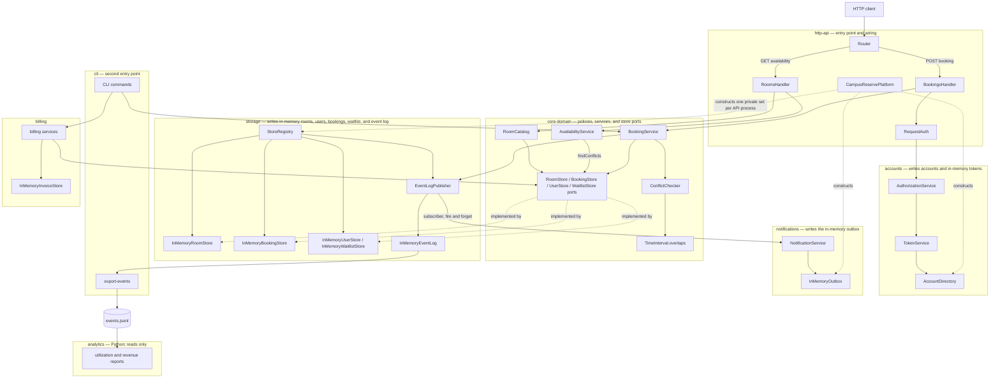

# BOUNDARIES.md

One section per milestone. Fill them in in order (the sketch before you write
anything about it, the copies next, the proposal last).

Draw Milestone 1's sketch from the code. A TA may ask where each arrow came
from.

Keep it short and specific. Point at modules, files, and callers.

---

## Milestone 1: The architecture as built

### 1A. Architecture sketch

This diagram shows modules and runtime calls/data flow, not Maven dependency
arrows. Each API process has its own instance of the HTTP, accounts, core,
storage, and notifications components shown here. The CLI creates a separate
core/storage/billing platform; it does not read the HTTP process's event log.



`billing` writes invoices. `cli` exports its own in-memory event log to JSONL;
the HTTP in-memory log and the CLI in-memory log are distinct instances.
`InMemoryBookingStore.findConflicts` performs its own endpoint comparison;
availability does not take the `ConflictChecker -> TimeInterval.overlaps` path.

### 1B. Differences from `ARCHITECTURE.md`

- **Availability is missing from the repository diagram.** My sketch includes
  `RoomsHandler` → `AvailabilityService` → `BookingStore.findConflicts` →
  `InMemoryBookingStore`, while the repository's booking-flow diagram shows no availability path.
  **Verdict:** The sketch is right about the executed HTTP path;
  `ARCHITECTURE.md` is incomplete because it omits it.

- **Availability bypasses the documented conflict path.** My sketch does not route availability through `ConflictChecker` or `TimeInterval.overlaps`. Instead, `InMemoryBookingStore.findConflicts` performs its own endpoint comparison. **Verdict:** The sketch matches the code; the document's claim that every overlap decision uses `TimeInterval.overlaps` is false for this method.

- **The HTTP event log is not JSONL.** My HTTP-runtime path ends at
  `InMemoryEventLog`, while the repository diagram labels the booking output as an event log `(JSONL)`. The HTTP entry point does not construct the file-backed JSONL writer.
  **Verdict:** The sketch is right for the HTTP runtime; the diagram's `(JSONL)` label is too general.

- **Runtime state belongs to individual API processes.** The sketch's runtime
  notes identify stores, accounts, tokens, and outbox as private to each process. The
  repository diagram shows their logical module relationships but does not show that every `CampusReservePlatform` constructs a private copy of that state.
  **Verdict:** Both views are valid at different levels: the document's module dependencies are correct, but the sketch adds the runtime boundary needed to reason about multiple copies.

### 1C. Evidence that settled each difference

The overlap discrepancy specifically concerns the architecture diagram's
"only overlap implementation" annotation and `AGENTS.md` rule 3. The process
boundary is described in the sketch's notes; it is not an enclosing Mermaid box.

- **Availability path:** I traced `CampusReservePlatform.buildRouter` to
  `RoomsHandler.availability`, then followed `freeOnDate`,
  `bookedMinutesOnDate`, and `openSlotsOnDate` into
  `BookingStore.findConflicts`.

- **Conflict path:** I listed the production callers and implementation of
  `findConflicts`. `AvailabilityService` calls it, and `InMemoryBookingStore`
  implements overlap with
  `start().isBefore(windowEnd) && windowStart.isBefore(end())`, without calling
  `ConflictChecker` or `TimeInterval.overlaps`.

- **Event-log implementation:** I traced construction from
  `CampusReservePlatform` to `StoreRegistry.inMemory`, which constructs an
  `InMemoryEventLog`. `StoreRegistry.withEventLogFile` constructs a
  `JsonlFileEventLogWriter`, but the HTTP platform never calls that factory.

- **Process boundary:** I read the `CampusReservePlatform` constructor. It
  creates its own `StoreRegistry`, `AccountDirectory`, `TokenService`,
  `AuthorizationService`, `NotificationService`, and `InMemoryOutbox`; none is
  injected from or shared with another process.

### Show your TA — Milestone 1

- Show the Mermaid sketch in section 1A.
- Point out at least two differences from section 1B and give their matching
  source-code checks from section 1C.
- Be ready to trace one path aloud:
  - Availability: `Router -> RoomsHandler -> AvailabilityService -> BookingStore`.
  - Booking: `Router -> BookingsHandler -> BookingService -> BookingStore`.

---

## Milestone 2: Run it as copies

### 2A. Stack and two-copy check

```sh
docker compose up --build --scale api=2 -d api proxy
```

Wait at least six seconds for nginx to refresh its DNS result. The token run
observed two distinct `X-Upstream` values. The direct booking run does not pass
through nginx and has no such header; it reached two separately inspected API
addresses. Addresses and tokens must be obtained again after a restart.

### Finding 1: tokens

#### Claim

A bearer token minted by one API copy works on every authenticated request,
regardless of which API copy nginx sends it to.

#### Script, thresholds, and result

`load/token-any-copy.js` sends 30 authenticated requests through `proxy`. Its
thresholds require all 30 requests to return 200 and require at least two
distinct `X-Upstream` values. Run it with a `u-1` token copied from one API
copy's startup log:

```sh
docker compose run --rm --no-deps -e "TOKEN=REPLACE_WITH_CURRENT_MEMBER_TOKEN" k6 run /load/token-any-copy.js
```

Result: the run saw two distinct upstreams, `172.19.0.2:8080` and
`172.19.0.3:8080`. All 30 requests reached the proxy, but only 12 of 30 (40%)
accepted the token. The `distinct_upstreams_seen` threshold passed with a count
of 2, while `token_works_on_answering_copy` failed at 40%. This falsifies the
claim: the token worked only when nginx selected the copy that minted it.

#### Explanation from the code

`TokenService` stores tokens in its instance field `byValue`. I traced
`CampusReserveServer.main` into the `CampusReservePlatform` constructor, which
creates a new `AccountDirectory`, `TokenService`, and `AuthorizationService` for
each process. A token issued at one startup is therefore absent from the other
copy's `TokenService`.

#### Kind of problem

This is replica-local session state: authentication correctness depends on
which replica receives the request. The replicas are not interchangeable, so the supposedly horizontally scaled service is stateful.

### Finding 2: bookings

#### Claim

Across all API copies, a room and time slot is confirmed at most once.

#### Script, thresholds, and result

`load/room-slot-at-most-once.js` sends the same booking concurrently to the two
API copies directly. Direct requests with each copy's own token prevent the
token problem from masking the booking problem. Its claim threshold requires at
most one 201 response; another threshold requires two valid booking decisions.
`load/run-booking-test.cmd` obtains the live container IPs and current tokens
before invoking k6:

```sh
load\run-booking-test.cmd
```

Use fresh API processes before repeating the booking experiment. Restarting
clears their in-memory bookings and mints new tokens, which the helper reads:

```sh
docker compose restart api
load\run-booking-test.cmd
```

Wait until both API startup logs contain their new tokens before running the
helper. The script now refuses to proceed if the member already has bookings,
so a repeated run cannot pass just because both copies already hold the slot.

Result: the script reached `172.19.0.2:8080` and `172.19.0.3:8080`. Both copies
returned 201 for room `r-1` at `2026-10-31T15:00:00Z` to
`2026-10-31T15:30:00Z`, producing two different confirmed booking IDs:
`bk-e6cbfc67-5f28-4260-b158-e1fc288f2dd7` and
`bk-3781801b-a372-4b8f-bc8a-55c4ae9b5f43`. The two-attempt and valid-response
thresholds passed, while `confirmed_bookings_for_same_slot` failed with a count
of 2. This falsifies the at-most-once claim.

#### Explanation from the code

Each `CampusReservePlatform` constructs its own `StoreRegistry.inMemory()`.
`BookingService.requestBooking` checks only that registry's
`InMemoryBookingStore` before saving. Neither copy can see the booking stored by
the other, so both can observe the slot as free and confirm it.

#### Kind of problem

This is a distributed safety violation caused by partitioned ownership of the
same logical booking data. The check-then-write operation is local to each
replica, so no shared boundary serializes the room-slot invariant.

### 2B. Agent proposal I checked

The agent proposed that each `CampusReservePlatform` owns an independent
`InMemoryBookingStore`, so two copies could both confirm the same slot. I
checked the constructor wiring and then sent the identical booking directly to
both live copies with their own tokens. Both returned 201 with different IDs,
confirming that the copies do not coordinate the room-slot invariant. This
experiment does not establish safety for concurrent requests within one process.

### Show your TA — Milestone 2

- Show `compose.yaml` and two live API copies with `docker compose ps`.
- Show `load/token-any-copy.js`; its run saw two upstreams
  (`172.19.0.2:8080` and `172.19.0.3:8080`) but accepted the token only 12 of
  30 times, so its claim threshold failed at 40%.
- Show `load/room-slot-at-most-once.js`. If asked to demonstrate it, run
  `load\run-booking-test.cmd`.
- Show that both copies returned 201 for the same slot and that
  `confirmed_bookings_for_same_slot` failed with `count=2`.
- Explain each failure using its corresponding code explanation above.
- Show section 2B as the agent suggestion that you independently checked.

---

## Milestone 3: One boundary

The proposal fixes the cross-copy double-booking failure from Milestone 2.

### 3A. Proposed boundary

Add a `BookingRepository` port in `core-domain` with atomic command operations
such as `createIfRoomAvailable(Booking)`, `modifyIfRoomAvailable(...)`, and
`cancel(...)`, plus the existing booking queries. The create and modify commands
return either the stored booking or a room-conflict result. Their contract is
that checking the current active bookings and committing the change happen as
one indivisible operation.

`storage` implements the port with one durable store shared by every API copy.
For example, a database implementation could serialize writes per room or use a
transaction plus a constraint that rejects overlapping active intervals. The
current in-memory implementation remains useful for unit tests and a
single-process deployment.

The room-conflict check and booking write move together behind this port.
All insertion paths, including waitlist promotion, must use the atomic create
operation; retaining a raw `save` bypass would leave the invariant unprotected.
`BookingService` keeps request orchestration, room and user existence checks,
duration and opening-hours policy, waitlisting, and event publication. The HTTP
handlers keep authentication, parsing, and response mapping. API copies may
still run independently, but none may confirm or modify a booking except through
the shared repository command.

### 3B. Data owner

The `storage` module owns authoritative booking records and the serialization
needed to change them. `core-domain` owns the port and the meaning of a booking,
but it may observe or mutate booking data only through `BookingRepository`.
`http-api`, `cli`, billing, and analytics must not open the booking database or
keep a writable replica. Read caches are allowed only if they cannot answer a
command or be treated as authoritative.

### 3C. Invariant owned by the boundary

For any room, no two active bookings stored by the platform may have overlapping
`TimeInterval`s. Code violates the boundary if it can create or modify an active
booking without the authoritative repository atomically checking and preserving
that condition. A caller-side `find` followed by `save` is therefore forbidden,
even if it appears correct with one process.

### 3D. Costs, limits, and when it is worthwhile

The project must maintain the port and both in-memory and durable
implementations, including contract tests that prove they return the same
results. A booking now pays database or network latency, and overlapping writes
for a popular room serialize instead of scaling with the number of API copies.
The team must operate shared storage, choose transaction and retry behavior, and
handle new timeout and partial-failure cases. Availability also becomes a
consistency decision: authoritative reads cost a store call, while cached reads
may be stale.

This boundary does not fix replica-local bearer tokens, make event publication
atomic with booking commits, or by itself enforce the separate invariant that a
user cannot hold overlapping bookings. Those require their own shared ownership
or transaction design. I would pay this cost when CampusReserve runs multiple
API copies because the current deployment demonstrably confirms the same slot
twice. If the system is guaranteed to remain one process, keeping the in-memory
store and avoiding the operational dependency is the cheaper design.

### Show your TA — Milestone 3

- Name the boundary: the atomic `BookingRepository` port in `core-domain`, with
  a shared implementation in `storage`.
- Name the owner: `storage` owns authoritative booking records and serializes
  changes.
- State exactly one invariant: no two active bookings for the same room may
  have overlapping intervals.
- Explain what moves: the conflict check and write become one repository
  operation. Policy, orchestration, authentication, and response mapping stay
  where they are.
- Defend the priced tradeoff: shared storage adds latency, contention,
  operations, retries, failure modes, and a second implementation to maintain.
- State what remains unfixed: replica-local tokens, event/booking atomicity, and
  cross-copy user-calendar conflicts.
